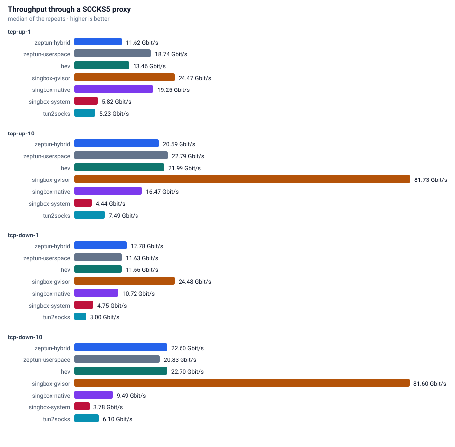
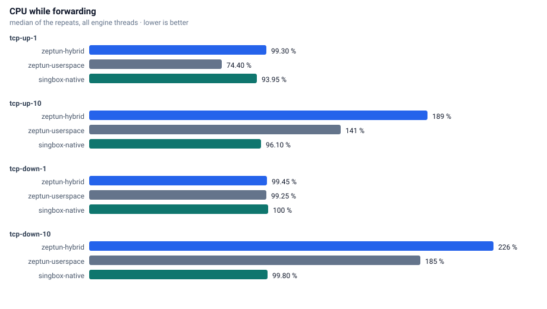
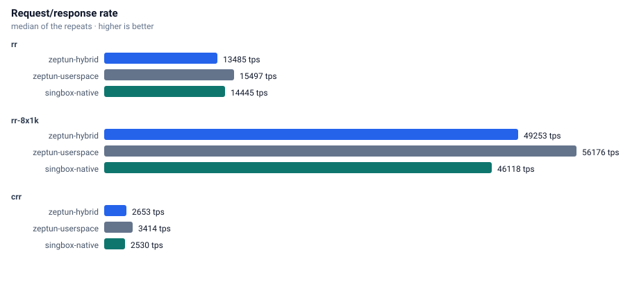
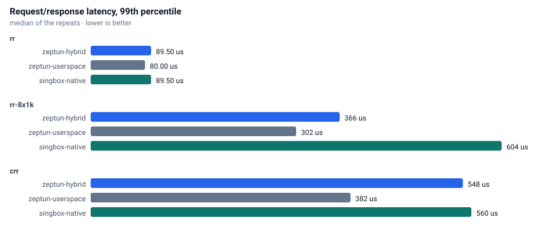
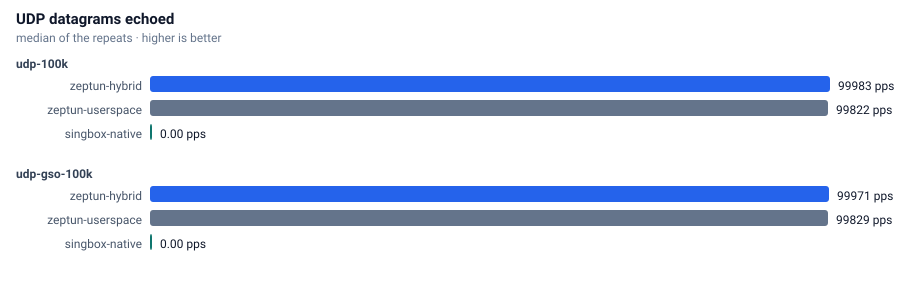
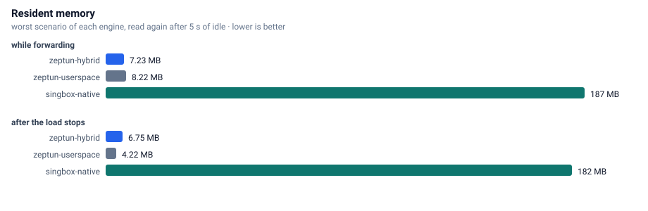

# Benchmarks

Every number on this page comes from the `benchmark` workflow in this repository, run on a GitHub-hosted runner.

## Machine

| property | value |
|---|---|
| runner image | ubuntu24 20261026.354.1 |
| cpu | AMD EPYC 9V74 80-Core Processor |
| cpu cores | 4 |
| memory | 15.6 GB |
| kernel | Linux 7.0.0-1017-azure |
| zig | 0.17.0 |
| date | 2026-11-04 |

## Method

Two network namespaces joined by a veth pair. Traffic enters the tunnel device (MTU 8500), leaves through the same SOCKS5 server (hev-socks5-server) for every engine, and reaches the servers in the second namespace. Engines are interleaved: each round starts every engine once and runs every scenario against it, so background noise spreads evenly. CPU comes from `/proc/<pid>/stat` and memory from `VmRSS`, summed over all processes of an engine.

Duration 8 s per scenario, 2 rounds, 4 queues. Memory is read twice: the highest sample while the scenario runs, and again after 5 s of idle, which shows whether an engine gives the memory back.

## Throughput

## CPU

## Request/response

## UDP

## Memory

## Raw results

| engine | scenario | median | cpu % | max rss MB | rss after idle MB |
|---|---|---:|---:|---:|---:|
| zeptun-userspace | tcp-up-1 | 19.167 Gbit/s | 88 | 2.9 | 1.4 |
| zeptun-userspace | tcp-up-10 | 23.680 Gbit/s | 141 | 7.5 | 1.9 |
| zeptun-userspace | tcp-down-1 | 11.854 Gbit/s | 99 | 2.2 | 2.1 |
| zeptun-userspace | tcp-down-10 | 21.007 Gbit/s | 179 | 6.1 | 2.5 |
| zeptun-userspace | rr | 11645 tps p50=84us p99=113us p99.9=125us  | 38 | 2.5 | 2.5 |
| zeptun-userspace | rr-8x1k | 39262 tps p50=188us p99=460us p99.9=856us  | 93 | 2.6 | 2.5 |
| zeptun-userspace | crr | 2192 tps p50=436us p99=608us p99.9=976us  | 44 | 4.4 | 4.4 |
| zeptun-userspace | udp-100k | 99984 echo pps (100.0% of 99992 sent)  | 60 | 4.9 | 4.4 |
| zeptun-userspace | udp-gso-100k | 99827 echo pps (99.8% of 99992 sent)  | 40 | 5.9 | 4.2 |
| hev | tcp-up-1 | 13.577 Gbit/s | 95 | 8.3 | 8.1 |
| hev | tcp-up-10 | 22.096 Gbit/s | 185 | 10.0 | 8.3 |
| hev | tcp-down-1 | 11.718 Gbit/s | 99 | 8.4 | 8.3 |
| hev | tcp-down-10 | 22.958 Gbit/s | 206 | 9.0 | 8.3 |
| hev | rr | 11339 tps p50=87us p99=114us p99.9=130us  | 43 | 8.3 | 8.3 |
| hev | rr-8x1k | 36731 tps p50=206us p99=448us p99.9=624us  | 132 | 8.4 | 8.3 |
| hev | crr | 1961 tps p50=496us p99=560us p99.9=640us  | 61 | 8.3 | 8.3 |
| hev | udp-100k | 99974 echo pps (100.0% of 100000 sent)  | 74 | 8.8 | 8.7 |
| hev | udp-gso-100k | 99966 echo pps (100.0% of 99988 sent)  | 73 | 8.9 | 8.8 |
| zeptun-hybrid | tcp-up-1 | 11.875 Gbit/s | 99 | 2.0 | 1.8 |
| zeptun-hybrid | tcp-up-10 | 20.593 Gbit/s | 191 | 3.6 | 2.7 |
| zeptun-hybrid | tcp-down-1 | 13.025 Gbit/s | 99 | 2.9 | 2.5 |
| zeptun-hybrid | tcp-down-10 | 22.711 Gbit/s | 217 | 3.6 | 2.7 |
| zeptun-hybrid | rr | 10359 tps p50=94us p99=122us p99.9=140us  | 44 | 2.7 | 2.6 |
| zeptun-hybrid | rr-8x1k | 34129 tps p50=222us p99=480us p99.9=616us  | 140 | 2.6 | 2.4 |
| zeptun-hybrid | crr | 1730 tps p50=560us p99=664us p99.9=736us  | 69 | 5.6 | 5.2 |
| zeptun-hybrid | udp-100k | 99980 echo pps (100.0% of 100000 sent)  | 70 | 6.0 | 5.4 |
| zeptun-hybrid | udp-gso-100k | 99969 echo pps (100.0% of 99988 sent)  | 39 | 6.0 | 5.5 |
| singbox-native | tcp-up-1 | 19.259 Gbit/s | 97 | 61.4 | 61.4 |
| singbox-native | tcp-up-10 | 16.502 Gbit/s | 98 | 69.3 | 69.3 |
| singbox-native | tcp-down-1 | 10.748 Gbit/s | 100 | 86.5 | 68.4 |
| singbox-native | tcp-down-10 | 9.662 Gbit/s | 100 | 91.4 | 91.4 |
| singbox-native | rr | 10796 tps p50=90us p99=123us p99.9=146us  | 47 | 91.7 | 91.7 |
| singbox-native | rr-8x1k | 30133 tps p50=230us p99=912us p99.9=1936us  | 91 | 91.7 | 91.7 |
| singbox-native | crr | 1512 tps p50=640us p99=776us p99.9=1344us  | 87 | 136.9 | 136.9 |
| singbox-native | udp-100k | 0 echo pps (0.0% of 99996 sent)  | 79 | 140.6 | 72.4 |
| singbox-native | udp-gso-100k | 0 echo pps (0.0% of 99984 sent)  | 48 | 72.5 | 71.1 |
| singbox-system | tcp-up-1 | 5.856 Gbit/s | 117 | 54.2 | 54.2 |
| singbox-system | tcp-up-10 | 4.470 Gbit/s | 169 | 54.5 | 54.5 |
| singbox-system | tcp-down-1 | 4.849 Gbit/s | 147 | 54.6 | 54.6 |
| singbox-system | tcp-down-10 | 3.797 Gbit/s | 134 | 54.7 | 54.7 |
| singbox-system | rr | 8731 tps p50=112us p99=140us p99.9=168us  | 65 | 54.7 | 54.7 |
| singbox-system | rr-8x1k | 25058 tps p50=300us p99=664us p99.9=1136us  | 151 | 54.8 | 54.8 |
| singbox-system | crr | 1338 tps p50=728us p99=832us p99.9=1488us  | 107 | 63.3 | 63.3 |
| singbox-system | udp-100k | 0 echo pps (0.0% of 99992 sent)  | 88 | 64.3 | 64.0 |
| singbox-system | udp-gso-100k | 0 echo pps (0.0% of 99988 sent)  | 89 | 64.2 | 64.0 |
| tun2socks | tcp-up-1 | 5.278 Gbit/s | 186 | 17.5 | 17.2 |
| tun2socks | tcp-up-10 | 7.726 Gbit/s | 272 | 35.3 | 35.2 |
| tun2socks | tcp-down-1 | 3.038 Gbit/s | 165 | 38.1 | 23.0 |
| tun2socks | tcp-down-10 | 6.162 Gbit/s | 265 | 130.5 | 130.5 |
| tun2socks | rr | 6836 tps p50=142us p99=184us p99.9=234us  | 71 | 144.7 | 144.7 |
| tun2socks | rr-8x1k | 22604 tps p50=332us p99=720us p99.9=1104us  | 163 | 145.5 | 139.3 |
| tun2socks | crr | 1299 tps p50=752us p99=944us p99.9=1888us  | 98 | 144.0 | 33.5 |
| tun2socks | udp-100k | 47106 echo pps (47.1% of 99988 sent)  | 229 | 34.5 | 32.0 |
| tun2socks | udp-gso-100k | 48992 echo pps (49.0% of 99967 sent)  | 241 | 36.7 | 33.9 |
| singbox-gvisor | tcp-up-1 | 24.557 Gbit/s | 0 | 0.0 | 0.0 |
| singbox-gvisor | tcp-up-10 | 82.947 Gbit/s | 0 | 0.0 | 0.0 |
| singbox-gvisor | tcp-down-1 | 24.557 Gbit/s | 0 | 0.0 | 0.0 |
| singbox-gvisor | tcp-down-10 | 82.083 Gbit/s | 0 | 0.0 | 0.0 |
| singbox-gvisor | rr | 37456 tps p50=25us p99=40us p99.9=47us  | 0 | 0.0 | 0.0 |
| singbox-gvisor | rr-8x1k | 160772 tps p50=47us p99=114us p99.9=640us  | 0 | 0.0 | 0.0 |
| singbox-gvisor | crr | 3854 tps p50=238us p99=296us p99.9=576us  | 0 | 0.0 | 0.0 |
| singbox-gvisor | udp-100k | 99992 echo pps (100.0% of 99992 sent)  | 0 | 0.0 | 0.0 |
| singbox-gvisor | udp-gso-100k | 99978 echo pps (100.0% of 99992 sent)  | 0 | 0.0 | 0.0 |

zeptun: startup 4 ms, idle 864 KB, 4 wakeups in 20 s | tcp 1000: 2836 KB (conns: 1000/1000 established, 0 failed, 2132 conn/s) | udp 1000: 2492 KB (udp flows: 1000/1000 answered, 9590 flows/s)
hev: startup 4 ms, idle 539 KB, 2 wakeups in 20 s | tcp 1000: 9282 KB (conns: 1000/1000 established, 0 failed, 2143 conn/s) | udp 1000: 9154 KB (udp flows: 1000/1000 answered, 7990 flows/s)
singbox-native: startup 52 ms, idle 53961 KB, 132 wakeups in 20 s | tcp 1000: 65756 KB (conns: 1000/1000 established, 0 failed, 1549 conn/s) | udp 1000: 68928 KB (udp flows: 0/1000 answered, 0 flows/s)
singbox-system: startup 51 ms, idle 53619 KB, 6 wakeups in 20 s | tcp 1000: 68134 KB (conns: 1000/1000 established, 0 failed, 1357 conn/s) | udp 1000: 64872 KB (udp flows: 0/1000 answered, 0 flows/s)
singbox-gvisor: startup 2993 ms, idle 0 KB, 0 wakeups in 20 s | tcp 1000: 0 KB (conns: 1000/1000 established, 0 failed, 4497 conn/s) | udp 1000: 0 KB (udp flows: 1000/1000 answered, 82598 flows/s)
tun2socks: startup 6 ms, idle 11148 KB, 278 wakeups in 20 s | tcp 1000: 58692 KB (conns: 1000/1000 established, 0 failed, 1248 conn/s) | udp 1000: 114408 KB (udp flows: 1000/1000 answered, 4531 flows/s)
