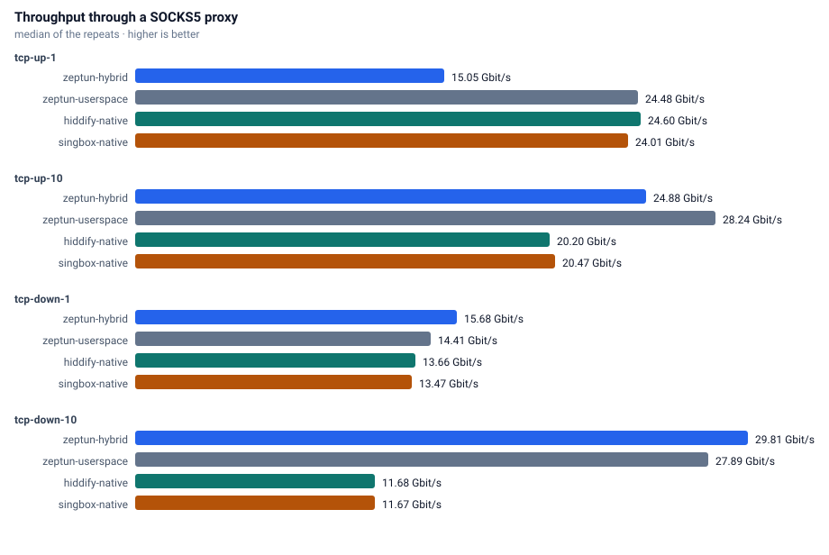
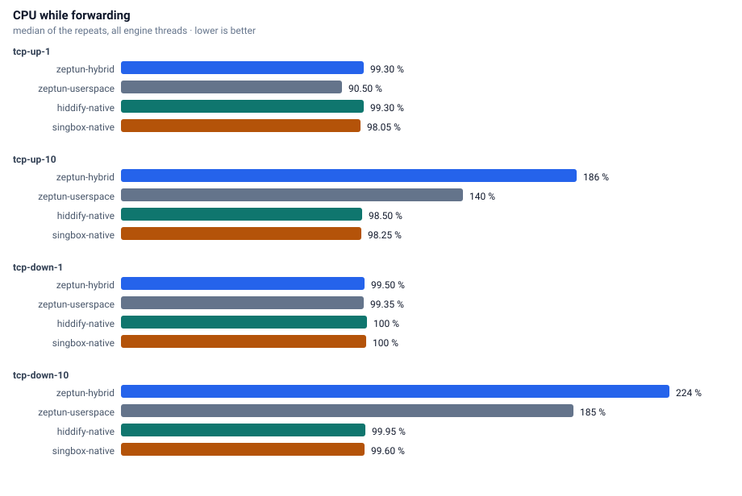
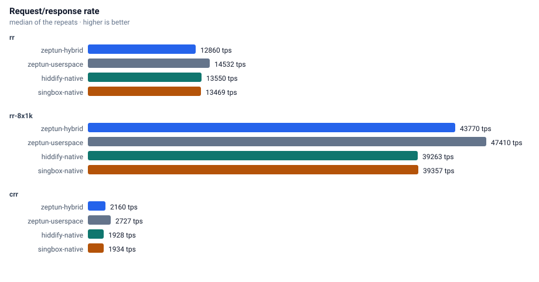
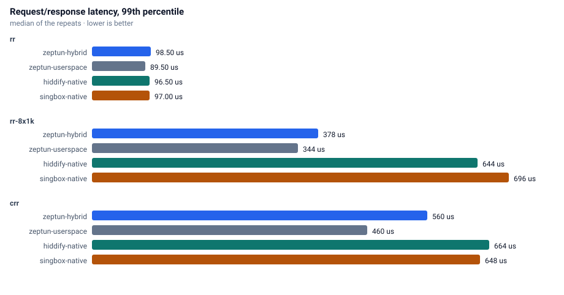
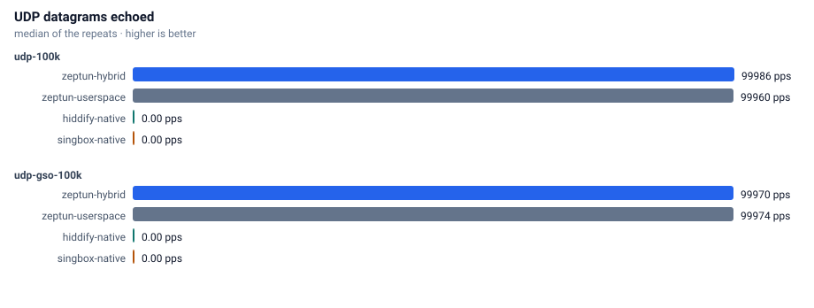
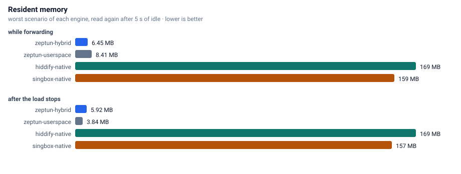

# Benchmarks

Every number on this page comes from the `benchmark` workflow in this repository, run on a GitHub-hosted runner.

## Machine

| property | value |
|---|---|
| runner image | ubuntu24 20261111.370.1 |
| cpu | AMD EPYC 9V74 80-Core Processor |
| cpu cores | 4 |
| memory | 15.6 GB |
| kernel | Linux 7.0.0-1017-azure |
| zig | 0.17.0 |
| date | 2026-11-16 |
| zeptun | v1.1.3 (Noisemux/zeptun release) |
| sing-box | v1.15.0-alpha.13 (sing-tun stack) |
| hiddify-core | v5.9.8 (hiddify/hiddify-core release, sing-tun stack) |

## Method

zeptun is the latest release binary of Noisemux/zeptun, and sing-box is the latest 1.15.0 alpha with no tun `stack` option, so it runs on sing-tun's own TCP/IP stack. hiddify-core is a release of hiddify/hiddify-core, whose sing-box fork is based on 1.15, running the same config with `srun`. Two network namespaces joined by a veth pair. Traffic enters the tunnel device (MTU 8500), leaves through the same SOCKS5 server (hev-socks5-server) for every engine, and reaches the servers in the second namespace. Engines are interleaved: each round starts every engine once and runs every scenario against it, so background noise spreads evenly. CPU comes from `/proc/<pid>/stat` and memory from `VmRSS`, summed over all processes of an engine.

Duration 8 s per scenario, 2 rounds, 4 queues. Memory is read twice: the highest sample while the scenario runs, and again after 5 s of idle, which shows whether an engine gives the memory back.

## Throughput

## CPU

## Request/response

## UDP

## Memory

## Raw results

| engine | scenario | median | cpu % | max rss MB | rss after idle MB |
|---|---|---:|---:|---:|---:|
| zeptun-userspace | tcp-up-1 | 24.583 Gbit/s | 90 | 2.9 | 1.4 |
| zeptun-userspace | tcp-up-10 | 29.256 Gbit/s | 140 | 9.2 | 2.4 |
| zeptun-userspace | tcp-down-1 | 14.441 Gbit/s | 99 | 2.6 | 2.5 |
| zeptun-userspace | tcp-down-10 | 28.998 Gbit/s | 185 | 6.2 | 2.6 |
| zeptun-userspace | rr | 14647 tps p50=66us p99=89us p99.9=100us  | 37 | 2.6 | 2.6 |
| zeptun-userspace | rr-8x1k | 48996 tps p50=154us p99=344us p99.9=480us  | 92 | 2.7 | 2.5 |
| zeptun-userspace | crr | 2776 tps p50=344us p99=456us p99.9=1056us  | 44 | 4.4 | 4.2 |
| zeptun-userspace | udp-100k | 99962 echo pps (100.0% of 99988 sent)  | 48 | 4.9 | 4.2 |
| zeptun-userspace | udp-gso-100k | 99980 echo pps (100.0% of 99992 sent)  | 31 | 5.0 | 4.1 |
| zeptun-hybrid | tcp-up-1 | 15.295 Gbit/s | 99 | 2.0 | 1.8 |
| zeptun-hybrid | tcp-up-10 | 25.328 Gbit/s | 186 | 3.6 | 2.7 |
| zeptun-hybrid | tcp-down-1 | 15.706 Gbit/s | 100 | 2.9 | 2.5 |
| zeptun-hybrid | tcp-down-10 | 30.222 Gbit/s | 224 | 3.6 | 2.7 |
| zeptun-hybrid | rr | 12943 tps p50=75us p99=98us p99.9=328us  | 44 | 2.7 | 2.5 |
| zeptun-hybrid | rr-8x1k | 45092 tps p50=166us p99=372us p99.9=520us  | 148 | 2.5 | 2.3 |
| zeptun-hybrid | crr | 2167 tps p50=452us p99=536us p99.9=672us  | 69 | 6.0 | 5.7 |
| zeptun-hybrid | udp-100k | 99987 echo pps (100.0% of 99992 sent)  | 71 | 6.5 | 5.9 |
| zeptun-hybrid | udp-gso-100k | 99978 echo pps (100.0% of 99992 sent)  | 31 | 6.4 | 6.0 |
| singbox-native | tcp-up-1 | 24.040 Gbit/s | 98 | 61.5 | 61.5 |
| singbox-native | tcp-up-10 | 20.665 Gbit/s | 98 | 65.3 | 65.3 |
| singbox-native | tcp-down-1 | 13.613 Gbit/s | 100 | 79.0 | 68.9 |
| singbox-native | tcp-down-10 | 11.724 Gbit/s | 100 | 100.5 | 100.5 |
| singbox-native | rr | 13559 tps p50=72us p99=96us p99.9=117us  | 46 | 100.5 | 100.5 |
| singbox-native | rr-8x1k | 40774 tps p50=180us p99=464us p99.9=840us  | 90 | 104.8 | 104.8 |
| singbox-native | crr | 1936 tps p50=500us p99=680us p99.9=1216us  | 86 | 159.2 | 159.2 |
| singbox-native | udp-100k | 0 echo pps (0.0% of 99988 sent)  | 63 | 159.5 | 73.6 |
| singbox-native | udp-gso-100k | 0 echo pps (0.0% of 99992 sent)  | 38 | 73.7 | 71.8 |
| hiddify-native | tcp-up-1 | 24.919 Gbit/s | 99 | 87.8 | 87.8 |
| hiddify-native | tcp-up-10 | 20.581 Gbit/s | 98 | 96.3 | 92.5 |
| hiddify-native | tcp-down-1 | 13.697 Gbit/s | 100 | 92.2 | 84.9 |
| hiddify-native | tcp-down-10 | 11.742 Gbit/s | 100 | 120.3 | 120.3 |
| hiddify-native | rr | 13608 tps p50=71us p99=96us p99.9=117us  | 46 | 120.3 | 120.3 |
| hiddify-native | rr-8x1k | 40020 tps p50=176us p99=616us p99.9=1248us  | 92 | 120.4 | 80.3 |
| hiddify-native | crr | 1938 tps p50=500us p99=648us p99.9=1392us  | 85 | 169.5 | 169.5 |
| hiddify-native | udp-100k | 0 echo pps (0.0% of 99988 sent)  | 65 | 173.1 | 88.3 |
| hiddify-native | udp-gso-100k | 0 echo pps (0.0% of 99992 sent)  | 40 | 87.8 | 87.4 |

zeptun: startup 3 ms, idle 852 KB, 4 wakeups in 20 s | tcp 1000: 2816 KB (conns: 1000/1000 established, 0 failed, 2582 conn/s) | udp 1000: 2448 KB (udp flows: 1000/1000 answered, 10707 flows/s)
singbox-native: startup 40 ms, idle 54604 KB, 71 wakeups in 20 s | tcp 1000: 65119 KB (conns: 1000/1000 established, 0 failed, 1928 conn/s) | udp 1000: 68639 KB (udp flows: 0/1000 answered, 0 flows/s)
hiddify-native: startup 26 ms, idle 67964 KB, 12 wakeups in 20 s | tcp 1000: 79584 KB (conns: 1000/1000 established, 0 failed, 1854 conn/s) | udp 1000: 86539 KB (udp flows: 0/1000 answered, 0 flows/s)
